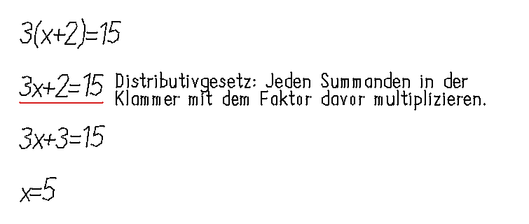

# reMarkable Atlas

**Samuel Fleig** · [samuelfleig.com](https://samuelfleig.com)

**Handschrift, Stift, Feedback — ohne den Lernfluss zu verlassen.**

Seit Oktober 2026 baue ich an einem Mathe-Tutor für das reMarkable Paper Pro. Der Anspruch: Ein Blatt Papier soll rechnen können. Wer eine Aufgabe schreibt, bekommt einen kurzen Hinweis neben der eigenen Handschrift — kein Chatfenster, kein Handy, keine App dazwischen.

Der Weg dahin war nicht gerade. **188 dokumentierte Versuche, sieben Vorläufer-Codebasen, zwei Retrospektiven.** Die 188 stammen aus `algebra-graveyard` und zählen einzelne Varianten-Läufe; die ältere Retrospektive `remarkable-graveyard` zählt 25 übergeordnete Versuche und 69 klassifizierte Fehler. Beide Datensätze überlappen sich — die 63 Fehler des älteren Snapshots sind in den 188 Versuchen enthalten — und keiner ersetzt den anderen. Was hier steht, ist deshalb nicht die Erfolgsgeschichte, sondern der belastbare Teil davon: was funktioniert, was nicht, und woran man es erkennt.

---

## Wenn du nur zwei anschaust

- **[penecho](projekte/penecho.md)** — sechs prüfbare Punkte, die definieren, wann der Tutor fertig ist. Der ganze Rest ist die Antwort auf diese sechs Punkte.
- **[algebra-agent](projekte/algebra-agent.md)** — die einzige Umsetzung, die den Kreis schließt: lesen, prüfen, zurückschreiben.

Der ehrliche Stand: erfüllt sind **0 von 3** erprobten Sitzungen.

---

## Der Kern

| Projekt | Was es kann | Reifegrad | Detail |
|---|---|---|---|
| **algebra-agent** | Liest die Seite, findet den ersten falschen Rechenschritt, schreibt einen Hinweis als Tinte daneben. | Prototyp | [Detail](projekte/algebra-agent.md) |
| **penecho** | Der Produktvertrag: sechs prüfbare Punkte, die erfüllt sein müssen, bevor von einem Tutor die Rede ist. | Dokument | [Detail](projekte/penecho.md) |
| **penecho-mac** | Menüleisten-App, die den Tutor ohne Terminal bedienbar macht. | Prototyp | [Detail](projekte/penecho-mac.md) |
| **penecho-lens** | Fenster in die Maschine: zeigt Schritt für Schritt, was der Agent gerade tut. | Werkzeug | [Detail](projekte/penecho-lens.md) |

## Zulieferer und Messgeräte

| Projekt | Was es kann | Reifegrad | Detail |
|---|---|---|---|
| **inkpartner** | Denkt sich einen Lehrer mit Rotstift: Haken, Kreis, Fragezeichen — nach festen Regeln, nicht nach Modelllaune. | Prototyp | [Detail](projekte/inkpartner.md) |
| **underline** | Unterstreicht die falsche Zeile rot und hakt richtige grün ab, ohne die Handschrift anzutasten. | Prototyp | [Detail](projekte/underline.md) |
| **pur** | Eine Seite, ein lokales Modell, ein angehängter Text. Ohne Cloud, ohne Konto. | Prototyp | [Detail](projekte/pur.md) |
| **budget** | Schickt beim Zurückschreiben nur den neuen Byte-Anhang und zählt Requests, Bytes und Tokens. | Werkzeug | [Detail](projekte/budget.md) |
| **keepitsimple** | Messplatz: liest den Stiftstrom live mit und stellt mehrere Tutor-Antworten zum Blindvergleich. | Werkzeug | [Detail](projekte/keepitsimple.md) |
| **mlops-gedanken** | 18 echte Seiten, Ground Truth, Benchmarks — und der Nachweis, welche Pipeline-Stufe wirklich trägt. | Werkzeug | [Detail](projekte/mlops-gedanken.md) |

## Rückblick und Umfeld

| Projekt | Was es kann | Reifegrad | Detail |
|---|---|---|---|
| **algebra-graveyard** | Chronik des Scheiterns: 188 Versuche, 13 Fehlermuster, 15 Lehren — jeder Satz mit Beleg. | Archiv | [Detail](projekte/algebra-graveyard.md) |
| **remarkable-graveyard** | Dieselbe Idee kompakt: 25 Versuche, 69 Fehler, 34 Sackgassen in einer Offline-Seite. | Archiv | [Detail](projekte/remarkable-graveyard.md) |
| **skills-paper-pro** | Zehn beschriebene Arbeitsabläufe vom Verbinden bis zum Feedback-Schreiben. | Dokument | [Detail](projekte/skills-paper-pro.md) |
| **rm-drill** | Mitschnitt einer Prüfungsvorbereitung: Frage vorgelesen, Antwort aufs Tablet gemalt, Agent liest zurück. | Archiv | [Detail](projekte/rm-drill.md) |
| **remake-website** | Portfolio als nachgebauter Mac-Desktop im Browser: Sperrbildschirm, Dock, Fenster. | Prototyp | [Detail](projekte/remake-website.md) |
| **CherryPicking** | Der Plan für danach: nur noch zusammenführen, was am Gerät belegt ist. | Plan | [Detail](projekte/cherrypicking.md) |

---

## Reifegrad

Die Skala ist absichtlich streng. „Fertig" heißt hier: auf dem Gerät belegt, nicht: Tests grün.

| Stufe | Bedeutung |
|---|---|
| **Produkt** | Auf dem Gerät erprobt und im Alltag benutzbar. *(derzeit von keinem Projekt erreicht)* |
| **Prototyp** | Die Technik läuft nachweislich; der Gerätebeleg oder die Dauererprobung fehlt. |
| **Werkzeug** | Für Entwicklung, Messung oder Fehlersuche gebaut — nicht für Endnutzer. |
| **Dokument** | Vertrag, Doku oder Nachschlagewerk. Kein ausführbarer Code. |
| **Archiv** | Abgeschlossen. Rückblick, keine Weiterentwicklung. |
| **Plan** | Noch kein Code. |

## Der Kern in einem Absatz

`algebra-agent` ist das einzige Projekt, das den ganzen Kreis schließt: Seite lesen, Schritt prüfen, Tinte zurückschreiben. Die übrigen 15 sind Zulieferer (`pur`, `underline`, `budget`, `inkpartner`), Messgeräte (`keepitsimple`, `mlops-gedanken`), Bedienoberflächen (`penecho-mac`, `penecho-lens`), Verträge und Nachschlagewerke (`penecho`, `skills-paper-pro`), Rückblicke (`algebra-graveyard`, `remarkable-graveyard`, `rm-drill`) oder Drumherum (`remake-website`, `CherryPicking`).

---

## Fremde Projekte

Zwei Ordner im Workspace sind **nicht** meine Arbeit und stehen hier nur als Referenz:

- [`smart_remarkable`](referenzen.md#smart_remarkable) — Rust-Agent von Yang Wu, Fork von `awwaiid/ghostwriter`.
- [`math-vision`](referenzen.md#math-vision) — Rust-CLI von Mikail Plotzky.

Beide sind im Abschnitt [Referenzen](referenzen.md) beschrieben, mit klarer Herkunftsangabe.

## Sichtbarkeit

Dieses Repo ist **öffentlich**, die Projekt-Repos sind **privat**. Die Seiten sind deshalb so geschrieben, dass sie ohne den Code lesbar sind; die Repo-Pfade stehen als Text in den Kopfzeilen.

Öffentlich erreichbar ist derzeit nur [`inkpartner`](https://github.com/smlfg/inkpartner) — ein Forschungsprototyp, der den Rotstift-Ansatz zeigt, aber nicht auf dem Gerät belegt ist.

## Kontakt

Samuel Fleig · [samuelfleig.com](https://samuelfleig.com)

Wenn dich ein Projekt interessiert und du den Code sehen willst: schreib mir, ich gebe die Repos frei.
