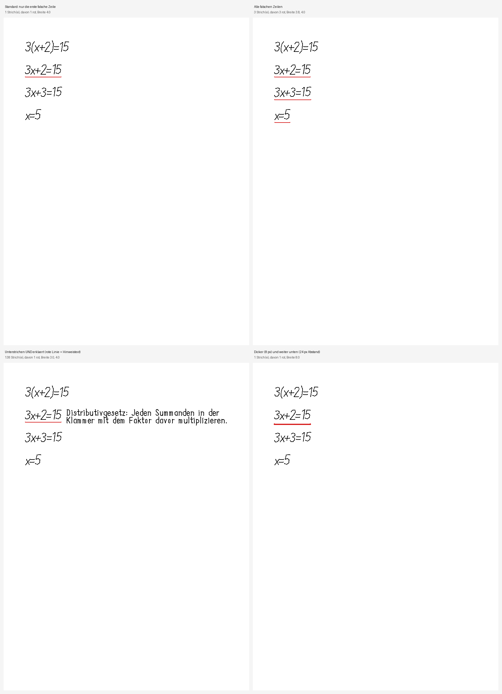

# algebra-agent

**Ein Satz:** Der Python-Kern des Algebra-Tutors — liest Handschrift von einer Paper-Pro-Seite, bestimmt den ersten falschen Rechenschritt und schreibt einen kurzen Hinweis als Tinte auf dieselbe Seite zurück.

**Repo:** `https://github.com/smlfg/algebra-agent` (privat)
**Reifegrad:** Prototyp
**Stack:** Python 3 · ~36.700 Zeilen · 967 Testmethoden
**Nutzen:** Ersetzt die Rückfrage bei einem Menschen: ein Hinweis in Sekunden, direkt auf der Seite, ohne den Lernfluss zu unterbrechen.
**Belegt:** 967 Testmethoden im Repo; das Anhängen lässt die Schülertinte byte-identisch, und die Originalblöcke bleiben erhalten.

---

## Kann

- Eine `.rm`-Seite einlesen und ihre Originalblöcke byte-gleich erhalten; neue Striche landen in einer eigenen Ebene „PenEcho Agent".
- Handschrift über austauschbare Vision-Backends lesen (Gemini, MiniMax, Ollama, Fake). Zwei unabhängige Lesungen müssen übereinstimmen — sonst gilt die Zeile als unsicher und wird nie grün.
- Schritte deterministisch prüfen: exakte Bruch- und Polynomprüfung bis Grad 2, die benannte Regeln erkennt (Distributivgesetz, Vorzeichenfehler), dazu SymPy-Prüfer für einzelne Themengebiete.
- Drei Rückschreibwege: rote Linie unter der falschen Zeile, rote Linie plus grüner Haken plus Text, oder volle Markierung. Mit Abstand zur Schülertinte; bei Platzmangel wird bewusst nichts geschrieben — in dichten Diagrammen greift diese Regel aber noch nicht zuverlässig (siehe Probleme).
- Einen Notebook-Loop mit Auslöse-Erkennung, Agentenprofilen, Modellkette und Tageskontingent betreiben.

## Kann nicht

- Kein erprobtes Geräteprodukt: Die Definition of Done verlangt drei Sessions mit je drei Wechseln — Stand **0 von 3**, Status „experimentell".
- Kein allgemeiner Mathe-Tutor. Abgedeckt sind Gleichungen einer Variablen bis Grad 2 sowie einzelne Themenprüfer (Binärrechnung, Trigonometrie, Integrale, Folgen, Vektoren). Freie Beweise fehlen.
- Der nahtlose Stiftweg überträgt nur eine Farbe und verweigert ohne gemessene Viewport-Kalibrierung das Schreiben.
- Das Lesen hängt an Cloud-Modellen mit 20 Anfragen pro Tag und Modell. Ist die Kette leer, wird der Turn geparkt statt geraten.

## Bild

Vier Varianten derselben Seite: nur die erste falsche Zeile markiert, alle falschen Zeilen, zusätzlich mit Hinweistext, sowie eine dickere und tiefer gesetzte Linie. So wurde die Platzierung am Gerät entschieden.

## Erklärung

Das Werkzeug übernimmt, was sonst ein Mensch am Tisch tut: auf die Rechnung schauen und sagen, wo es hakt. Es liest die Seite, prüft Zeile für Zeile und schreibt einen kurzen Hinweis direkt daneben auf das Papier, ohne die eigene Handschrift anzutasten. Der Hinweis nennt eine Regel, nicht die Lösung — damit man selbst weiterrechnen kann. Der Nutzen: Der Lernfluss bleibt am Blatt erhalten, weil keine App dazwischenliegt. Ob das zuverlässig funktioniert, ist noch nicht belegt: Die Technik läuft, die geforderte Dauererprobung fehlt.

## 18a-Benchmark (05.11.2026)

Eine Aufgabe, zwei Schülerstände, elf Tutor-Strategien, ein Richter, ein Durchgang je Stand.

- **Offener Fall (`L = ?`):** Der Richter wählt `nextstep`. Eigene Top 3: `nextstep`, `concept`, `socratic`.
- **Fehlerfall (`L₁ = {π/4}`, `L₂ = {5π/6}`):** Der Richter wählt `algebra_agent`, obwohl der nur `L₂` adressiert. Beide Mengen vollständig lokalisieren `errorlocal`, `nextstep` und `socratic` (3 von 11).
- **Leak:** Die Gegenprobe `penecho_musterloesung` verrät in beiden Fällen die Lösung (2/2) und ist in beiden fachlich falsch (2/2); im offenen Fall fehlt `17π/6`, im Fehlerfall ist die genannte `L₂`-Menge falsch.
- **Evidence:** `mathcheck.analyse` lieferte für beide Zustände keinen Befund.

Der Lauf belegt eine Richterpräferenz, keine Tutorqualität. Grenzen: eine Aufgabe, ein Richter, ein synthetischer Schülerstand, keine Lernwirkung, ein Modell. Der Gerätebeweis bleibt bei 0 von 3 Sitzungen.

Belege im Repo [`keepitsimple`](keepitsimple.md): `docs/BENCHMARK-18A-2026-11-05.md` und `docs/BENCHMARK-18A-FEHLER-2026-11-05.md`; Rohdaten in `arena/runs/benchmark-18a-2026-11-05.jsonl` und `arena/runs/benchmark-18a-fehler-2026-11-05.jsonl`; Einordnung in `docs/uebergabe/12-tutor-evaluation.md`.

## Probleme

- **`stepcheck` vergleicht jede Zeile mit der Originalgleichung.** Nach dem ersten Fehler wird dadurch jede spätere, für sich korrekte Zeile rot; Grün kann nie folgen. Seit 20.10. dokumentiert, im Code weiterhin vorhanden.
- **Hinweisplatzierung scheitert auf dichten Diagrammen.** Gemessen: „drawback found no free spot", ein Anker außerhalb der Seitenfläche, 400 px Abstand statt daneben.
- **Live-Viewport-Kalibrierung ist nicht gemessen.** Bis dahin schreibt der nahtlose Weg bewusst nichts.
- **Der Arbeitsbaum ist nicht eingefroren.** Branch `wip/vor-parallelisierung`, drei geänderte Dateien plus unversioniertes `.agent-control/`.
