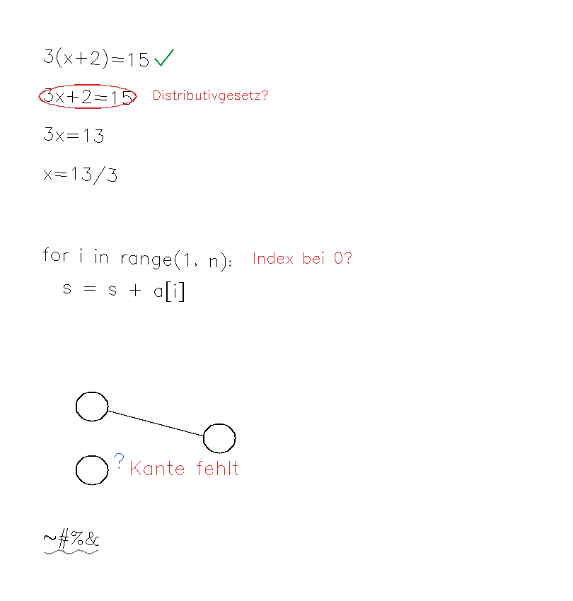

# inkpartner

**Ein Satz:** Ein Python-Prototyp für einen reMarkable-Tutor, der eine Seite als Elemente liest, Antworten prüft und das Urteil in eine feste Sprache aus Stiftzeichen übersetzt.

**Repo:** https://github.com/smlfg/inkpartner (**öffentlich**)
**Reifegrad:** Prototyp
**Stack:** Python 3, rmscene, Pillow, sympy, numpy · ~6.300 Zeilen · 93 Tests auf `main`
**Nutzen:** Zeigt, dass Rückmeldung nicht nur Text sein muss — ein Haken und ein Kreis sind schneller zu erfassen als ein Satz.
**Belegt:** 93 Tests auf `main`; Zeichensprache und Guards sind durch Fixtures abgedeckt, nicht durch einen Gerätelauf.

---

## Kann

- `.rm`-Seiten als Elemente lesen (Zeile, Formel, Code-Zeile, Diagrammknoten) mit Bounding-Boxen und eine eigene Agentenebene anhängen, ohne die Originalbytes zu verändern.
- Mathematik mit SymPy prüfen und den Prüfer das Modell überstimmen lassen; richtig belegte Schritte bekommen automatisch einen Haken.
- Sieben Zeichenarten zeichnen — Haken, Unterstreichen, Kreis, Wellenlinie, Fragezeichen, Notiz, Pfeil — mit einer Farbe, die aus dem Urteil folgt, nicht aus dem Modell.
- Regeln und Guards durchsetzen: unsicher wird nie grün, höchstens 3–4 Zeichen pro Runde, kein doppeltes Schreiben, Readback mit drei Ergebnissen, Retry mit Circuit Breaker, Verwerfen veralteter Hinweise, Not-Aus bei fremder Tinte.
- Fünf Fachprofile unterstützen (`math`, `code`, `diagram`, `pm`, `prose`) und optional Sprache mit lokaler Piper-Stimme.

## Kann nicht

- Die tatsächliche Übertragung aufs Tablet liegt nicht in diesem Repo; der unterbrechungsfreie Weg läuft nur über den virtuellen Stift aus `algebra-agent`.
- Es gibt keinen echten Modelllauf in der Testsuite — die Modellanfrage ist nur mit einem Fake-Client geprüft.
- Farbe und eigene Ebene lassen sich heute nicht gleichzeitig mit unterbrechungsfreiem Schreiben haben. Der Zielkonflikt ist im README offen benannt.
- Nur Mathematik lässt sich deterministisch prüfen; die anderen Fächer hängen am Modell, und ein Lösungsverrat wird nicht maschinell erkannt.

## Bild

Vier Beispielzeilen: Mathe mit grünem Haken und rotem Kreis samt Notiz, eine Codezeile mit blauem Fragezeichen, ein Diagramm mit fehlender Kante und eine unleserliche Zeile mit grauer Wellenlinie.

## Erklärung

Der Prototyp denkt sich einen Lehrer mit Rotstift: Er schaut auf die Seite, erkennt Rechenschritte und markiert, was richtig oder falsch ist. Farbe und Zeichenart folgen festen Regeln, nicht der Laune des Sprachmodells. Gedacht ist das für Lernen am Tablet, ohne Chatfenster und ohne die Seite zu verlassen. Der Stand ist ein Forschungsprototyp: Vieles ist simuliert, die Übertragung aufs echte Gerät steckt in einem anderen Projekt.

## Probleme

- Die Position der Marken am Gerät ist nicht belegt: Der Kreis-Test stand laut Handoff vom 24.10. aus; danach folgte nur ein Commit.
- Die Regel „automatisch reagieren" widerspricht dem Produktvertrag „bewusst auslösen". Der Widerspruch ist ausdrücklich zur Entscheidung gestellt und nicht entschieden.
- Ohne frischen Stiftstrich ist die Ansicht nur über einen Probestrich messbar; Verbindungsverlust und hängende Lese-Prozesse auf dem Tablet sind nicht automatisch behandelt.
- Der spätere Arbeitsstand liegt nur auf nicht gemergten Branches: `main` hat 93 Tests, die README nennt 25, und 12 Worktrees sind als `prunable` markiert.
