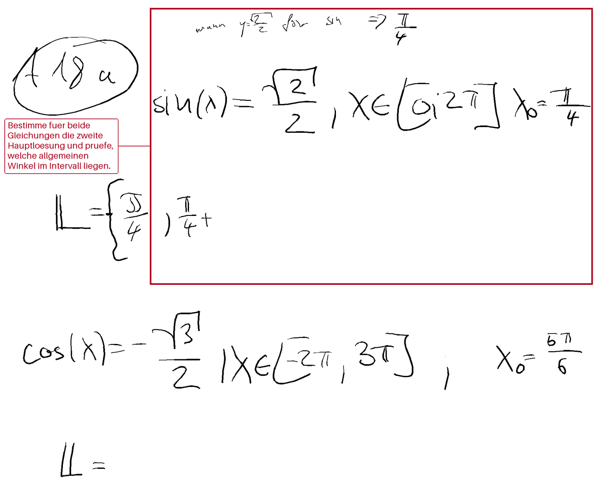

# keepitsimple

**Ein Satz:** Ein rein lokales Beobachtungs- und Messwerkzeug, das den Stiftstrom des reMarkable mitschreibt, Handschrift per lokalem Modell in Zeilen übersetzt und mehrere Tutor-Antworten zum Vergleich anbietet.

**Repo:** `https://github.com/smlfg/keepitsimple` (privat)
**Reifegrad:** Werkzeug
**Stack:** Python 3, Pillow, lokales Ollama, SymPy · ~15.900 Zeilen · 441 Testmethoden
**Nutzen:** Ersetzt Bauchgefühl durch einen Blindvergleich: elf Tutor-Strategien, eine menschliche Wahl, ein Messwert.

---

## Kann

- Den rohen Stiftstrom über SSH von `/dev/input/event2` lesen, daraus Striche bauen und laufend ein PNG zeichnen. Der Audit zählte 456.790 Events, 682 Striche und 0 `SYN_DROPPED`.
- In einer Live-Konsole links die Tinte und rechts die gelesene Zeilenliste zeigen. Gefragt wird erst nach einer Schreibpause, gesteuert von einer reinen Zeitfunktion.
- Elf Tutor-Strategien als austauschbare Module laden — u. a. `baseline`, `socratic`, `nextstep`, `errorlocal`, `check`, `concept`, `analogy`, zwei PenEcho-Varianten), anonym mischen, durch einen blinden Richter bewerten und die menschliche Wahl als JSONL protokollieren.
- Vor jedem Tutor-Prompt einen SymPy-Befund über die Zeilen legen, ohne Lösungswerte zu verraten.
- Messreihen fahren: Reader-Benchmark, Pipeline-Benchmark, Taskscore gegen Referenzhinweise, Varianz bei Temperatur 0, Live-Log, Offline-Replay, Report und ein begrenzter MLOps-Lauf. Die gewählte Antwort lässt sich lokal vorlesen.

## Kann nicht

- Nicht auf das Tablet zurückschreiben. Es wird nur ein Annotation-Plan gebaut und hostseitig gerendert; der Geräteadapter fehlt ausdrücklich.
- Keine Wahrheit über die Transkription: Es gibt keine Referenzlösung. „Fehlerfrei" heißt nur, dass kein Fehlertext und keine leere Liste auftrat.
- Nur lokal und nur mit einer Handschrift: Abhängigkeit von Ollama und dessen Speicher, ein Gerätepfad, eine Handschrift. Cloud-Betrieb oder Training sind nicht gebaut.
- Die Live-Latenz liegt im Mittel bei rund 15–17 s pro Anfrage, weil zeilenweise Ausschnitte noch fehlen.

## Bild

Dry-Run auf dem Host: roter Rahmen um den erkannten Aufgabenbereich, roter Hinweiskasten links. Auf das Tablet wurde dabei nichts geschrieben.

## Erklärung

Das Projekt beobachtet, wie ein Mathe-Tutor auf echter Handschrift abschneidet, ohne dabei etwas zu verändern. Es liest den Stiftstrom mit, macht daraus ein Bild, lässt ein lokales Sprachmodell die Zeilen abtippen und zeigt mehrere mögliche Tutor-Antworten nebeneinander. Der Mensch wählt die hilfreichere — aus diesen Wahlen entsteht Messmaterial statt Bauchgefühl. Der Nutzen: Tutor-Qualität wird vergleichbar, bevor man sich auf eine endgültige Lösung festlegt. Es ist bewusst ein Messplatz, kein Lernprodukt.

## Probleme

- Der Richter zitiert den SymPy-Befund in **0 von 10 Fällen** — der Befund entsteht also entweder nicht oder kommt nicht an.
- Der Zeilen-Zusammenkleber führt fünf Zeilen zu einer zusammen; `17·17` wird zu `17.17` und `3×3` zu `3+3`. Das ändert die Bedeutung.
- `--record` überschreibt die Datei; dadurch ging eine Aufzeichnung verloren.
- `mathcheck.analyse` liefert bei gemischten Zeilen aus Gleichung, Intervall und Startwert keinen Befund — der Benchmark lief deshalb ohne CAS-Beleg.
