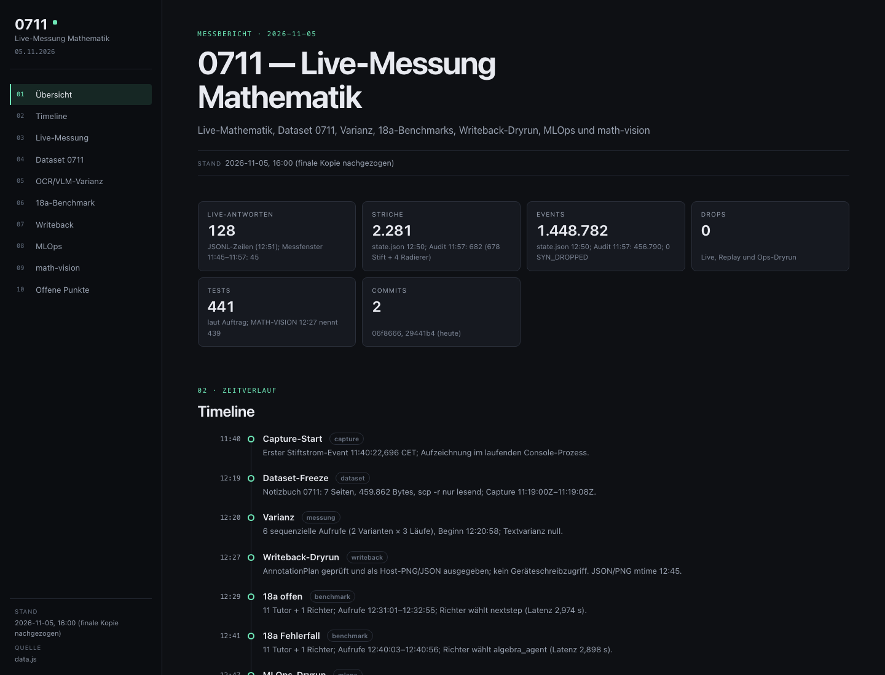
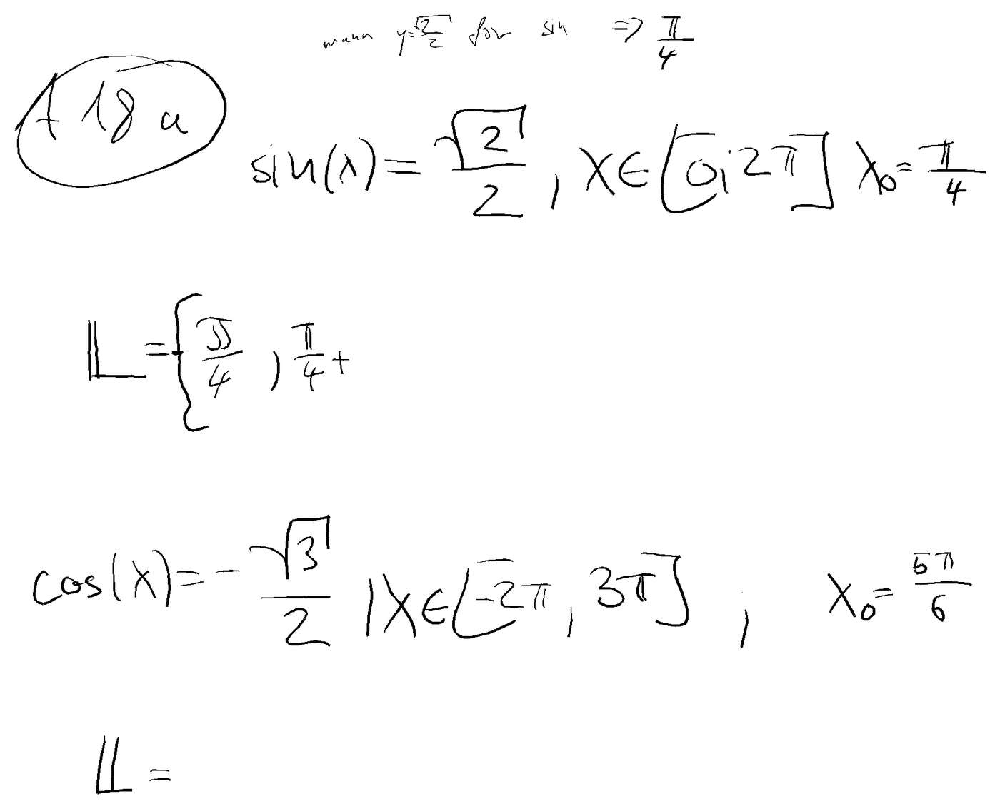
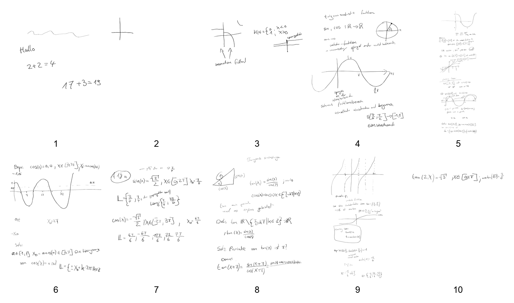

# keepitsimple

**Ein Satz:** Ein rein lokales Beobachtungs- und Messwerkzeug, das den Stiftstrom des reMarkable mitschreibt, Handschrift per lokalem Modell in Zeilen übersetzt und mehrere Tutor-Antworten zum Vergleich anbietet.

**Repo:** `https://github.com/smlfg/keepitsimple` (privat)
**Reifegrad:** Werkzeug
**Stack:** Python 3, Pillow, lokales Ollama, SymPy · ~15.900 Zeilen · 441 Testmethoden
**Nutzen:** Ersetzt Bauchgefühl durch einen Blindvergleich: elf Tutor-Strategien, eine menschliche Wahl, ein Messwert.
**Belegt:** 441 Testmethoden; live 2.281 Striche und 1.448.782 Stift-Events bei 0 `SYN_DROPPED` (state.json, 12:50). Der Audit-Snapshot um 11:57 zählte 682 Striche und 456.790 Events.

---

## Kann

- Den rohen Stiftstrom über SSH von `/dev/input/event2` lesen, daraus Striche bauen und laufend ein PNG zeichnen. Live: 2.281 Striche, 1.448.782 Events, 0 `SYN_DROPPED`; der Audit-Snapshot um 11:57 hielt 682 Striche und 456.790 Events fest.
- In einer Live-Konsole links die Tinte und rechts die gelesene Zeilenliste zeigen. Gefragt wird erst nach einer Schreibpause, gesteuert von einer reinen Zeitfunktion.
- Elf Tutor-Strategien als austauschbare Module laden — u. a. `baseline`, `socratic`, `nextstep`, `errorlocal`, `check`, `concept`, `analogy`, zwei PenEcho-Varianten), anonym mischen, durch einen blinden Richter bewerten und die menschliche Wahl als JSONL protokollieren.
- Vor jedem Tutor-Prompt einen SymPy-Befund über die Zeilen legen, ohne Lösungswerte zu verraten.
- Messreihen fahren: Reader-Benchmark, Pipeline-Benchmark, Taskscore gegen Referenzhinweise, Varianz bei Temperatur 0, Live-Log, Offline-Replay, Report und ein begrenzter MLOps-Lauf. Die gewählte Antwort lässt sich lokal vorlesen.

## Kann nicht

- Nicht auf das Tablet zurückschreiben. Es wird nur ein Annotation-Plan gebaut und hostseitig gerendert; der Geräteadapter fehlt ausdrücklich.
- Keine Wahrheit über die Transkription: Es gibt keine Referenzlösung. „Fehlerfrei" heißt nur, dass kein Fehlertext und keine leere Liste auftrat.
- Nur lokal und nur mit einer Handschrift: Abhängigkeit von Ollama und dessen Speicher, ein Gerätepfad, eine Handschrift. Cloud-Betrieb oder Training sind nicht gebaut.
- Die Live-Latenz lag im ruhigen Fenster bei p50 15,15 s / p95 16,99 s, unter paralleler Benchmark-Last bei p50 23,74 s / p95 44,97 s. 9 von 128 Antworten waren `UNBRAUCHBAR` (7,0 %), 7 davon am `num_predict`-Limit. Eine Genauigkeitszahl gibt es nicht, weil Referenzzeilen fehlen.

## Bild

Dry-Run auf dem Host: roter Rahmen um den erkannten Aufgabenbereich, roter Hinweiskasten links. Auf das Tablet wurde dabei nichts geschrieben.

Die Messübersicht vom 05.11.2026: 128 Live-Antworten, 2.281 Striche, 1.448.782 Ereignisse ohne einen einzigen `SYN_DROPPED`, 441 Tests — darunter die Timeline, die für jede Stufe festhält, was tatsächlich lief. Der Punkt „Writeback-Dryrun" nennt ausdrücklich: kein Geräteschreibzugriff.

## Erklärung

Das Projekt beobachtet, wie ein Mathe-Tutor auf echter Handschrift abschneidet, ohne dabei etwas zu verändern. Es liest den Stiftstrom mit, macht daraus ein Bild, lässt ein lokales Sprachmodell die Zeilen abtippen und zeigt mehrere mögliche Tutor-Antworten nebeneinander. Der Mensch wählt die hilfreichere — aus diesen Wahlen entsteht Messmaterial statt Bauchgefühl. Der Nutzen: Tutor-Qualität wird vergleichbar, bevor man sich auf eine endgültige Lösung festlegt. Es ist bewusst ein Messplatz, kein Lernprodukt.

## Probleme

- Der Richter zitiert den SymPy-Befund in **0 von 10 Fällen** — der Befund entsteht also entweder nicht oder kommt nicht an.
- Der Zeilen-Zusammenkleber führt fünf Zeilen zu einer zusammen; `17·17` wird zu `17.17` und `3×3` zu `3+3`. Das ändert die Bedeutung.
- `--record` überschreibt die Datei; dadurch ging eine Aufzeichnung verloren.
- `mathcheck.analyse` liefert bei gemischten Zeilen aus Gleichung, Intervall und Startwert keinen Befund — der Benchmark lief deshalb ohne CAS-Beleg.
- Der für 13:08 geplante Recapture scheiterte um 13:18:40 mit `Network is unreachable`; ein Retry fand nicht statt. Die finale 10-Seiten-Kopie entstand erst um 15:00 in einem zweiten Lauf.
- `state.json`-mtime und `version` sind keine Lebendigkeitssignale: Die Konsole erhöht `version` alle 0,2 s auch ohne Eingabe, während `strokes` und `events` seit 12:45 unverändert sind. Echte Signale sind `strokes`, `events` und `responses[-1]`.
- Der 18a-Richter entscheidet rubrik-, aber nicht ziel-konform: Im Fehlerfall wählt er `algebra_agent`, das nur `L₂` adressiert; vollständig lokalisieren `errorlocal`, `nextstep` und `socratic`.
- Die Zeilensegmentierung ist der größte Hebel: 22 von 128 Antworten (17,2 %) bestehen aus genau einer Zeile. `crop_ink` schickt die ganze Tinte als ein Bild, obwohl die 10 Seiten 2.247 Striche mit 43.523 Punkten liefern.

## 05.11.2026 — Live-Messung, finales Dataset, Übergabe

| Kennzahl | Wert | as_of | Quelle |
|---|---|---|---|
| Live-Antworten | 128 | 12:45:49 (letzte Antwort) | `arena/runs/live-mathe-20261105.jsonl` |
| Striche | 2.281 | state.json, 12:50 | `console/state.json` |
| Events | 1.448.782 | state.json, 12:50 | `console/state.json` |
| Drops | 0 | 12:50 | `console/state.json`; jede JSONL-Zeile |
| `UNBRAUCHBAR` | 9 / 128 (7,0 %) | 12:17:05–12:45:49 | JSONL, `text[0]` |
| Finales Dataset | 10 Seiten, 766.737 B, 10/10 Hashes | 15:00 | `docs/DATASET-0711-2026-11-05-FINAL.md` |
| Tests | 441 | 05.11.2026 | `python3 -m unittest discover -s tests -t .` |
| Replay | 109 Snapshots, 783.137 Events, 0 Drops; nur Dry-Run | 05.11.2026 | `arena/runs/density-q15-i20-121051/meta.json` |
| Ops-Dryrun | 120 Snapshots, 992.115 Events, 1.463 Striche, 0 Drops, 4,59 s | 12:39 | `arena/runs/ops-full-20261105/meta.json` |

Das finale Dataset ist die zweite, nach Vorlesungsende nachgezogene Kopie des Notizbuchs „0711": 10 Seiten, 766.737 B, 10 von 10 Hashes identisch, ausschließlich lesend kopiert. Die 12:19-Fassung hatte 7 Seiten und 459.862 B; sie bleibt separat. Die Seiten liegen als Render und Tinten-Crop vor, Wahrheitszeilen enthalten die JSON-Seiten nicht.

Für die MLOps-Optimierung liegen 12 Übergabepakete im Repo (Commit `0e45f4a`). Jedes Paket folgt demselben Schema: Problem, Messung, Code, Optionen, Flywheel-Versuche, Definition of Done. Sie benennen unter anderem den fehlenden Retry beim Recapture, die Lücke im Live-Log, den einen 35B-Slot, die fehlende kanonische `metrics.json`, das fehlende Goldset, die Zeilensegmentierung und die Richter-Rubrik.

Bei 18a wählt der Richter im offenen Fall `nextstep`, im Fehlerfall `algebra_agent`. Diese Wahl ist rubrik-konform, aber nicht ziel-konform: `algebra_agent` adressiert nur `L₂`; vollständig lokalisieren `errorlocal`, `nextstep` und `socratic`. `penecho_musterloesung` leakt in beiden Fällen und ist in beiden fachlich falsch; im offenen Fall fehlt `17π/6`.

Die Segmentierung bleibt der größte Hebel. 22 von 128 Live-Antworten (17,2 %) haben genau eine Zeile; der Reader bekommt die ganze Tinte als ein Bild. Dabei liegen die 10 Seiten als 2.247 Striche mit 43.523 Punkten vor; reine y-Bänder ergeben 4 (18a), 6 (Graphseite) und 12 (dichteste Seite).

Die Website `docs/uebersicht-2026-11-05/index.html` zeigt Kennzahlen, Zeitverlauf und Benchmarks. Sie ist eine Momentaufnahme mit mehreren `as_of`-Ständen; maßgeblich sind die datierten Werte oben.

Der 18a-Ausschnitt stammt aus dem 7-Seiten-Snapshot von 12:19, nicht aus einer Live-Aufnahme. Er zeigt die Aufgabe vollständig, einschließlich beider Lösungsfelder.

Kontaktbogen der 10 Seiten aus der finalen Kopie um 15:00, in Manifest-Reihenfolge nummeriert. Seite 5 ist eine lange Scrollseite und wird deshalb stark verkleinert dargestellt.

> **Was nicht behauptet wird**
>
> - Kein Live-Writeback: Auf das Tablet wurde nichts geschrieben; der Writeback endet als Annotation-Plan und Host-Render.
> - Keine Genauigkeit: Es gibt keine Referenzzeilen und damit keine Exact- oder CER-Zahl. 100 % Selbstwiederholung ist Stabilität, nicht Richtigkeit.
> - Kein Lernerfolg: Gemessen wurde eine Tutorantwort, nicht ob der Schüler den nächsten Schritt danach selbst kann.
> - Eine Aufgabe, ein Richter: 18a hat zwei Zustände und je einen Richterdurchgang; das ist eine Fallserie, keine Rate.
> - Keine Produktreife: Das Projekt bleibt ein Messplatz ohne Geräte-Writeback und ohne belegte Tutorqualität.
