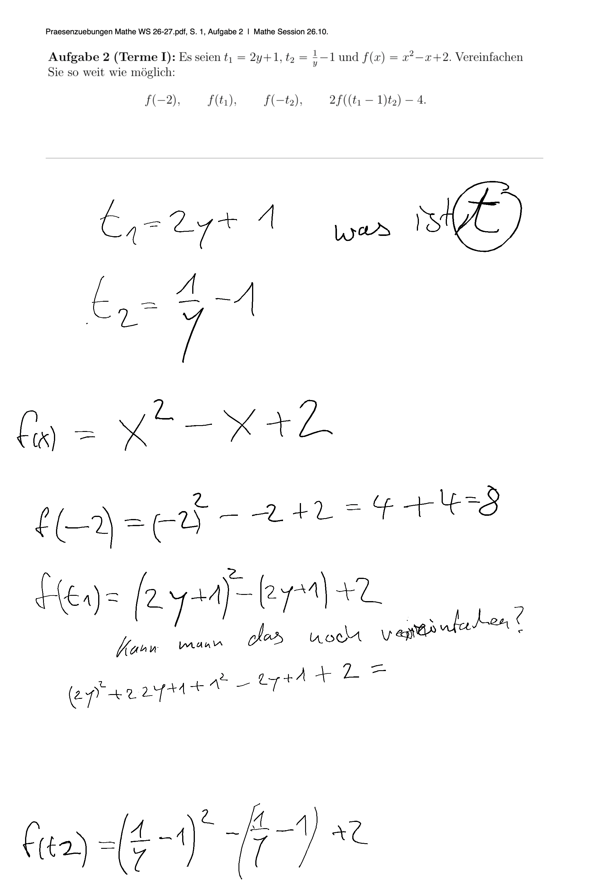

# mlops-gedanken

**Ein Satz:** Ein Mess- und Dokumentationsrepo, das MLOps-Prinzipien auf einen reMarkable-Mathe-Tutor anwendet: echte Handschriftseiten als Prüfkorpus, Benchmarks für OCR und Tutor, plus ein experimenteller Live-Adapter.

**Repo:** `https://github.com/smlfg/mlops-gedanken-umsetzung` (privat)
**Reifegrad:** Werkzeug
**Stack:** Python (Skripte, `unittest`) und Markdown · ~3.100 Zeilen im Arbeitsbaum · 13 Testfunktionen
**Nutzen:** Zeigt, was Sicherheitsregeln kosten: 40 von 51 richtigen Zeilen wurden ohne Messung verworfen.
**Belegt:** 18 Seiten mit Ground Truth und ein Benchmark-Report: 51 von 56 Zeilen roh richtig, 11 von 56 nach den Guardrails.

---

## Kann

- 18 echte Seiten aus Schul- und Uni-Mathe, PDF-Arbeitsblättern, Code und Notizen als „Forschungssafe" mit Metadaten und Ground Truth bündeln.
- Diese Seiten automatisiert benchmarken und Ergebnisse als JSON und Markdown-Reports festhalten.
- Leser-Varianten zeilengenau gegen Ground Truth vergleichen; der 10-Seiten-Report weist **51 von 56** rohen Treffern gegen **11 von 56** nach den Guardrails aus.
- Einen experimentellen Live-Adapter betreiben, der eine `.rm`-Seite per SSH liest, per Ollama erkennt, einen Tutor-Hinweis erzeugt und lokal über Piper vorliest.
- Ergebnisse per Skript nach Notion veröffentlichen und HTML-Auswertungen erzeugen.

## Kann nicht

- Kein eigenständiges Produkt: keine App, kein Deployment, kein Schreibweg aufs Tablet; der Live-Adapter endet bei einem vorgelesenen Hinweis.
- Der Live-Adapter ist auf genau eine Seite und Dokument-ID festgelegt, rendert die PDF-Aufgabe nicht mit und erkennt Seitenwechsel nicht zuverlässig.
- Ein laufender Prozess oder ein abgespielter Ton belegt keinen fachlich korrekten, gehörten Hinweis; der allgemeine Live-Tutor gilt ausdrücklich als nicht verifiziert.
- Große Teile der neuesten Arbeit sind untracked; der HEAD-Stand ist unvollständig.

## Bild

Eine echte, aus dem Tablet gerenderte Mathe-Seite aus dem Benchmark-Korpus.

## Erklärung

Das Projekt ist das Laborbuch zu einem Mathe-Tutor auf dem reMarkable. Es sammelt echte Seiten, misst, wie gut Modelle die Handschrift lesen, und prüft Änderungen gegen dieselben Seiten. Der zentrale Befund: Ohne Messung eingebaute Sicherheitsregeln warfen 40 von 51 richtig gelesenen Zeilen weg. Der Nutzen liegt im Nachweis, welche Pipeline-Stufe wirklich trägt — nicht in einer fertigen App.

## Probleme

- Die Zwei-Leser-Sperre senkt die Ausbeute laut Messung von 91,1 % auf 19,6 %; der Befund ist dokumentiert, aber nicht als automatisches CI-Gate abgesichert.
- Der Live-Tutor ist nicht verifiziert; Seitenwechsel ohne neuen Stiftstrich werden nicht zuverlässig erkannt.
- Hauptrepo, Laborpipeline und PDF-/TTS-Konfiguration sind nicht zu einem eindeutig getesteten Stand verbunden.
- Der Arbeitsbaum hat 73 uncommittete Einträge; `live-mlops/` und `forschungssafe/` fehlen im letzten Commit. Ein Root-README fehlt ebenfalls.
