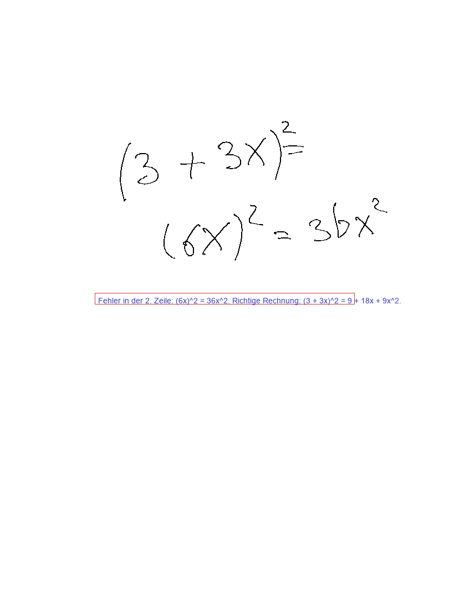

# pur

**Ein Satz:** Eine einzelne `.rm`-Seite wird lokal von einem Vision-Modell gelesen, dessen Antwort als getippter Textblock an dieselbe Seite angehängt wird — ohne Cloud und ohne App auf dem Tablet.

**Repo:** `https://github.com/smlfg/remarkable-pur-mac` (privat)
**Reifegrad:** Prototyp
**Stack:** Python 3, rmscene, Pillow, Ollama · ~620 Zeilen Produktivcode · 31 Tests
**Nutzen:** Prüft eine Seite ohne Cloud, ohne Konto, ohne dass die Handschrift verloren geht.
**Belegt:** 31 Tests ohne Modell und ohne Netz; die Originalbytes bleiben nachweislich vorn.

---

## Kann

- Eine `.rm`-Seite (Format v6) zu Strichen, Text und Seitenmaßen lesen und daraus ein PNG für das Modell rendern.
- Ein lokales Ollama-Modell per HTTP mit Bild und Prompt aufrufen; Standard ist `qwen2.5vl:7b` — ohne API-Key und ohne Cloud.
- Die Antwort als neuen `RootTextBlock` an die Seite hängen; die Originalbytes bleiben unverändert vorn, die Tinte bewegt sich nicht.
- Die Seitengröße aus `SceneInfo` auflösen (1620×2160 am Paper Pro) und per `--page-width/--page-height` überschreiben.
- `--dry-run`, `--preview`, `--json`, eigenen Prompt und Modellwahl bieten; 31 Tests laufen ohne Modell und ohne Netz.

## Kann nicht

- Kein Watcher, kein Ordner, kein Gerät: genau eine Datei pro Aufruf. SSH und xochitl-Neustart bleiben Handarbeit.
- Kein PDF- oder PNG-Export, keine Zeilenerkennung, keine Rechts-/Falsch-Marken — die Antwort ist Text.
- Kein Cloud-Modell und keine Modellverwaltung; Voraussetzung ist ein laufender Ollama-Server.
- Die genaue Platzierung des Textes auf dem Gerät und das Überleben eines Geräte-Speicherns sind ungeprüft.

## Bild

Vorschau der gerenderten Seite: Handschrift oben, darunter der vom Modell erzeugte Hinweis in einem Textkasten.

## Erklärung

`pur` nimmt eine handschriftliche Seite vom reMarkable, macht daraus ein Bild und schickt dieses Bild zusammen mit einer Frage an ein Sprachmodell, das auf dem eigenen Rechner läuft. Die Antwort wird nicht als Bild zurückgezeichnet, sondern als normaler getippter Text an die Seite angehängt; die Handschrift bleibt dabei unangetastet. Das ist nützlich, wenn jemand eine Rechnung prüfen lassen will, ohne die Seite vorher zu exportieren oder einen Cloud-Dienst zu benutzen. Der Nutzen ist bewusst klein gehalten: ein Durchlauf, eine Seite, ein lokal sichtbares Ergebnis.

## Probleme

- Ob xochitl den angehängten Text an der vorgesehenen Stelle zeigt, ist offen; `pos_x`/`pos_y` sind Vorschläge.
- Ob der Text ein Speichern auf dem Gerät überlebt, ist nicht gemessen.
- `plain_text()` räumt nur bekannte LaTeX-Befehle auf; `\sqrt{2}` kommt als `sqrt{2}` an.
