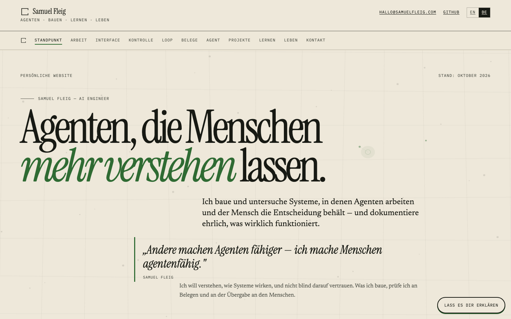

# remake-website

**Ein Satz:** Ein im Browser nachgebautes macOS-Desktop-Portfolio mit Sperrbildschirm, Menüleiste, Dock und sieben App-Fenstern, ergänzt um eine zweite statische Website-Variante.

**Repo:** `https://github.com/smlfg/remake-website` (privat)
**Reifegrad:** Prototyp
**Stack:** TypeScript/React 19, Vite, Tailwind CSS · ~3.700 Zeilen in `src/` · 0 Tests
**Nutzen:** Ein Portfolio, das man bedient statt scrollt.

---

## Kann

- Einen Sperrbildschirm mit Swipe, Klick und Enter, eine Menüleiste mit Uhr, WLAN und Batterie sowie ein Dock mit Magnification und Bounce darstellen.
- Sieben App-Fenster öffnen, am Titelbalken verschieben und per `Esc` schließen; die Kamera nutzt `getUserMedia`, Notizen speichern im `localStorage`.
- Sämtliche Inhalte — Name, Bio, Socials, Fotos, DJ-Sets, Termine, Projekte, Wallpaper — über eine einzige Konfigurationsdatei pflegen.
- Fenster per URL-Parameter direkt öffnen (`?open=photos,notes`) und den Sperrbildschirm überspringen (`?unlocked=1`).
- Eine zweite statische Fassung mit Deutsch und Englisch, Impressum, Datenschutz, Sitemap, Robots und 20 QA-Screenshots ausliefern.

## Kann nicht

- Kein Backend, kein CMS und keine echte Anmeldung; alle Inhalte sind statisch konfiguriert.
- Nicht veröffentlicht; Instagram, YouTube und TikTok sind noch Platzhalter.
- Keine Tests: kein Test-Runner, keine Spec-Dateien.
- Zwei Produkte in einem Repo: Shell und statische Seite sind unabhängig lauffähig, aber die Hoheitsentscheidung ist offen. Fotos, Fonts und Inhalte liegen doppelt.

## Bild

Die statische Fassung der Website im Browser.

## Erklärung

Die Seite tut so, als wäre sie ein Mac-Desktop im Browser: erst ein Sperrbildschirm, dann Menüleiste, Dock und Fenster, die sich wie Apps anfühlen. Dahinter steht ein Portfolio mit Fotos, Projekten, Terminen und einer About-Seite. Für Besucher ist das ein ungewöhnlicher Einstieg statt einer langen Scroll-Seite; für Samuel ist es zugleich ein Experiment mit Web-UI und die mögliche Basis für die eigene Domain. Veröffentlicht ist davon noch nichts.

## Probleme

- Die Grundsatzentscheidung ist offen, ob die Desktop-Shell oder die statische Seite die Hauptseite wird; README und Blueprint beschreiben zwei verschiedene Produkte.
- Die statische Fassung und die echten Fotos sind untracked; der letzte Commit enthält diese Arbeit nicht.
- Instagram, YouTube und TikTok sind Platzhalter und müssen vor einem Live-Gang ersetzt werden.
- Es gibt keine Tests; ob die Shell nach Änderungen noch funktioniert, wird nur manuell geprüft.
