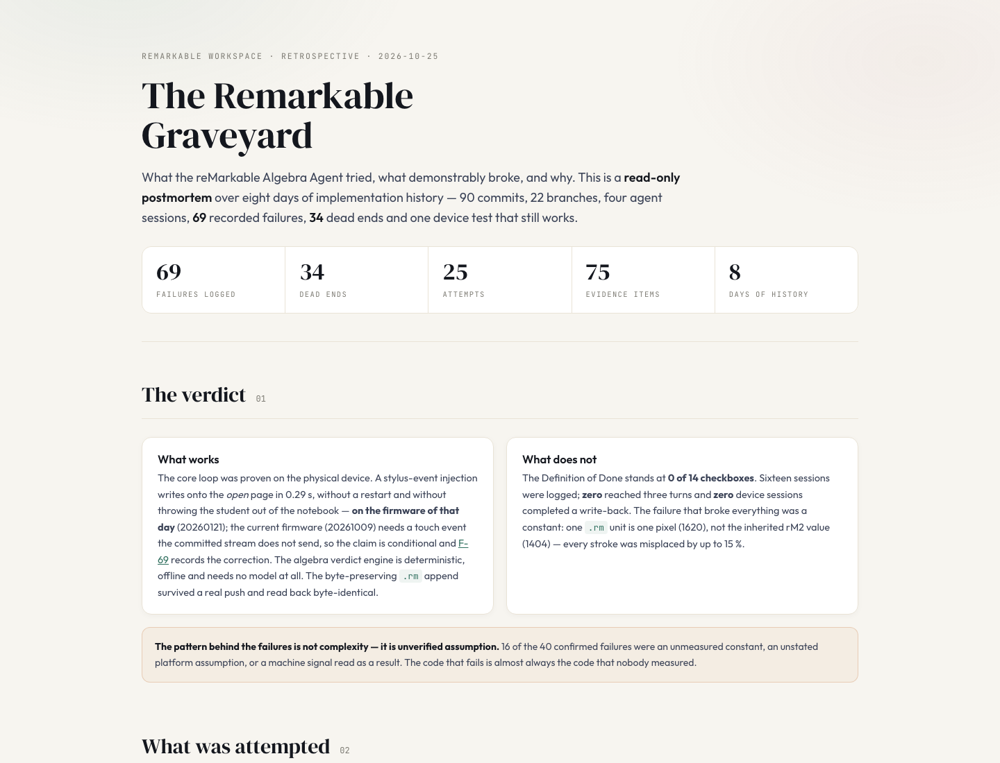

# remarkable-graveyard

**Ein Satz:** Eine belegbasierte Retrospektive des reMarkable-Algebra-Agenten mit 25 Versuchen, 69 klassifizierten Fehlern, 34 Sackgassen und 75 Belegen in einer offline lesbaren Seite.

**Repo:** `https://github.com/smlfg/remarkable-graveyard` (privat)
**Reifegrad:** Archiv
**Stack:** Python 3 (Generator und Prüfwerkzeuge), HTML/CSS/JS, JSON · ~570 Zeilen Python
**Nutzen:** Dieselbe Lehre in 300 KB, offline lesbar, ohne Server.
**Belegt:** 69 Fehler mit Ursache und Konfidenz; `build.py --check` hält Seite und Datensatz synchron.

Diese Retrospektive ist die **ältere** und zählt gröber als `algebra-graveyard`: 25 Versuche hier gegen 188 Varianten-Läufe dort. Alle 63 Fehler des Snapshots sind in den 188 enthalten; beide Datensätze wurden inhaltlich abgeglichen.

---

## Kann

- Die Retrospektive als eine offline funktionierende HTML-Datei (301 KB) mit eingebetteten Daten, Filter und Suche ausliefern; sie läuft per `file://` ohne Server.
- Den Datensatz maschinenlesbar halten: 25 Versuche, 69 Fehler, 34 Sackgassen, 75 Belege. Jeder Fehler mit Klassifikation, Subsystem, Konfidenz und Ursache.
- `index.html`, `FAILURE_LOG.md` und `DEAD_ENDS.md` aus demselben JSON-Datensatz erzeugen; `build/build.py --check` meldet, ob die Seite aktuell ist.
- Mit `tools/check_evidence.py` jede zitierte Quelle auflösen und `RESOLVED` oder `UNRESOLVED` melden.
- Ein `REPO_VERDICT.md` mit dem Vergleich der acht Nachbar-Repos und zwölf Lehren enthalten.

## Kann nicht

- Ändert keinen Anwendungscode und implementiert keine Fixes; das Archiv liest und dokumentiert nur.
- Greift nicht auf das Gerät zu; alle Geräteaussagen stammen aus vorhandenen Artefakten (Stand 25.10.2026).
- Deckt nur den Algebra-Agenten im Zeitraum 17.–24.10.2026 ab, kein allgemeines Werkzeug.
- Hat keine Testsuite; nur die Generator-Konsistenz wird geprüft.

## Bild

Die Startseite: 69 Fehler, 34 Sackgassen, 25 Versuche, 75 Belege — und daneben die Gegenüberstellung, was funktioniert und was nicht.

## Erklärung

Das Repo erzählt die Geschichte eines Projekts, das einen Mathe-Agenten für das reMarkable bauen sollte — als Belegsammlung statt als Erzählung. Jeder Fehler trägt eine Ursache, eine Konfidenz und einen Verweis auf Commit, Datei oder Sitzung; jede Quelle sagt auch, was sie nicht beweist. Die Seite lässt sich ohne Server im Browser öffnen, durchsuchen und filtern. Nützlich ist das für die nächste Person, die denselben Weg geht: Sie sieht, welche Annahmen schon einmal teuer waren, bevor sie sie wiederholt.

## Probleme

- Die Definition of Done steht bei **0 von 14**; keine Gerätesitzung mit drei Turns ist belegt.
- Die Kalibrierungsaussage ist im Repo nicht nachprüfbar: Die committete Evidenzdatei hat ein leeres `per-page`-Array, zwei Tests überspringen.
- Der binäre Rechner und das L2-Markenmodul sind uncommitted; wer den committeten Stand liest, findet sie nicht.
- Das Archiv selbst hat keinen Gerätezugriff; Farb- und Platzierungsfragen bleiben deshalb offen.
