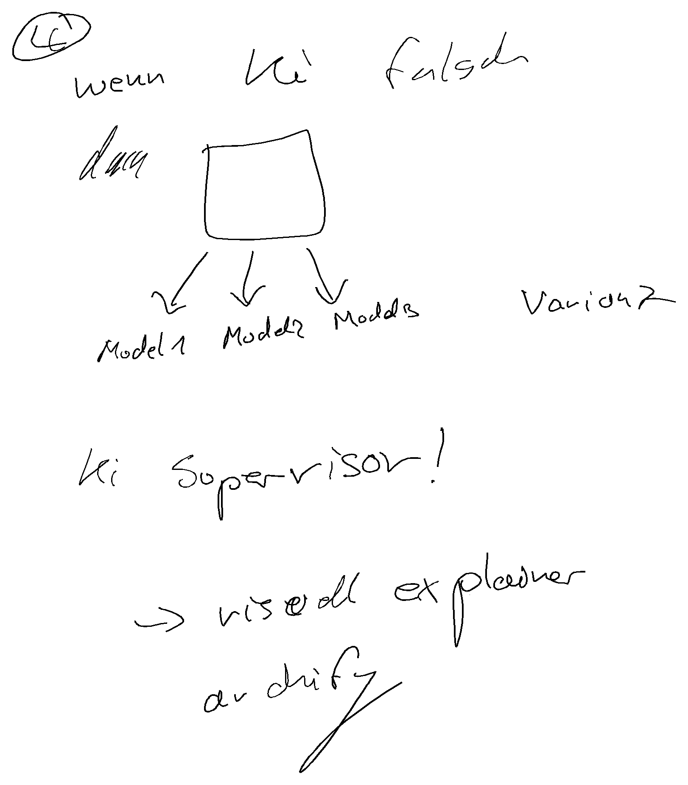

# rm-drill

**Ein Satz:** Ein archivierter Claude-Code-Sitzungsmitschnitt, der zeigt, wie der Skill `rm-drill` eine Prüfungsvorbereitung am Paper Pro als Vorlesen-und-Malen-Schleife führt — kein Anwendungscode.

**Repo:** `https://github.com/smlfg/rm-drill-mac` (privat, Ordner heißt lokal `claude/`)
**Reifegrad:** Archiv
**Stack:** JSONL-Mitschnitt, Markdown, PNG · 725 JSONL-Zeilen (doppelt, 8,8 MB)
**Nutzen:** Belegt, dass eine Sprach-plus-Stift-Schleife in 25 Minuten vier Runden schafft — ohne Tastatur.
**Belegt:** Der Mitschnitt selbst: vier Runden in 25 Minuten, ohne Tastatur.

---

## Kann

- Eine Sitzung vom 21.10.2026 vollständig als JSONL dokumentieren: 725 Zeilen mit Tool-Aufrufen und Ergebnissen.
- Die Schleife zeigen: Frage per Piper/Thorsten vorlesen, auf dem Tablet malen, Seite per SSH holen, nur neue Striche ab einem Zähler rendern, Antwort lesen, nächste Frage.
- Den Bau von `rm-drill` samt `rm.py` und `say.sh` als Heredocs im Mitschnitt belegen — inklusive `pkill afplay` gegen zwei gleichzeitige Stimmen und klarem Abbruch bei offline-Gerät.
- Zwei gerenderte Seiten aus dem Lauf enthalten.
- Die Dauer festhalten: vier Runden in 25 Minuten, ohne Tastatur.

## Kann nicht

- Kein ausführbarer Code im Repo: `rm.py`, `say.sh` und `SKILL.md` liegen nur als Text im Mitschnitt bzw. auf dem Rechner des Autors.
- Eine einzelne Sitzung ohne Test, Wiederholung oder Auswertung; Zuverlässigkeit lässt sich daraus nicht ableiten.
- Pfade verweisen auf lokale Verzeichnisse und sind nicht portabel.
- Bewertet Antworten über ein lesendes Modell, ohne Rechenprüfung.

## Bild

Handschriftliche Antwort des Nutzers aus der Sitzung: eine Architekturskizze zu „Wenn KI falsch …".

## Erklärung

Dieses Repo enthält keine Software, sondern die Aufzeichnung einer Claude-Code-Sitzung vom 21. Oktober 2026. Darin wird jemand kurz vor einem Bewerbungsgespräch abgefragt: Die Frage wird vorgelesen, er antwortet auf dem reMarkable, und der Agent holt die neu geschriebenen Striche von der Seite und bewertet sie. Nützlich ist der Mitschnitt als Beispiel dafür, wie eine Sprach-plus-Stift-Schleife in der Praxis aussieht — samt der Fehler, die dabei auftraten. Wer den Ablauf nachbauen will, muss die Skripte aus dem Mitschnitt extrahieren; das Repo selbst liefert sie nicht.

## Probleme

- Der Mitschnitt ist Rohmaterial: 8,8 MB JSONL mit persönlichem Gesprächsinhalt, keine kuratierte Fallstudie.
- Die Sitzung liegt doppelt (`transcript.jsonl` und `<uuid>.jsonl`, byte-identisch), was die Dateigröße verdoppelt.
- Die erzeugten Skripte sind nicht als Dateien versioniert; sie existieren nur im Text und auf dem Autor-Rechner.
- Die Aussagen stützen sich auf eine Sitzung mit vier Runden; eine Wiederholung fehlt.
