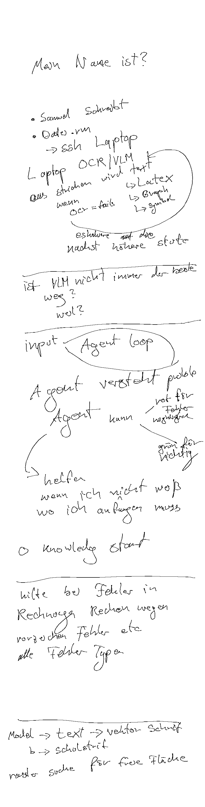

# skills-paper-pro

**Ein Satz:** Zehn deutsche Agenten-Skills, die typische Paper-Pro-Abläufe vom Verbinden über Handschriftlesen bis zum Feedback-Schreiben beschreiben — Dokumentation, kein Programm.

**Repo:** https://github.com/smlfg/skills-paper-pro (privat)
**Reifegrad:** Dokument
**Stack:** Markdown mit YAML-Frontmatter · 934 Zeilen · keine automatisierten Tests

---

## Kann

- Zehn Skills in deutschem Markdown mit YAML-Frontmatter, Inputs, Outputs, Vorgehen und Grenzen beschreiben: `rm-connect`, `rm-find`, `rm-view-page`, `rm-read-handwriting`, `rm-import`, `rm-export`, `rm-create-worksheet`, `rm-check-answer`, `rm-write-feedback`, `rm-drill`.
- Jede Einzeloperation mit Status katalogisieren: `vorhanden`, `lokal geprüft`, `Gerätebeleg offen`, `Automationslücke`.
- Einen Gerätetest vom 22.10.2026 dokumentieren: Seite per SSH geholt, SHA-256 remote und lokal gleich, Text-Writeback, Readback byte-identisch, 484 Striche unverändert.
- Für jeden Skill die konkreten Befehle aus `algebra-agent`, `underline` und `pur` nennen, statt eigene Implementierungen zu behaupten.
- Die YAML-Syntax aller Skills und die CLI-Hilfen prüfen; der Bericht hält fest, was nicht getestet wurde.

## Kann nicht

- Enthält keinen Programmcode und keine eigene Implementierung; die Skills rufen Befehle aus anderen Repos auf.
- Kein Skill wurde am echten Tablet ausgeführt; der beiliegende Gerätetest lief über die Nachbar-Repos.
- PDF-Import und -Export sind eine Automationslücke; es gibt keinen PDF-Parser im Workspace.
- Nicht global installiert und ohne automatische Tests.

## Bild

Lokales Rendering der echten, per SSH geholten Testseite (484 Striche) — kein Tablet-Screenshot.

## Erklärung

Das Repo ist ein Nachschlagewerk für zehn Arbeitsabläufe rund um das Paper Pro: verbinden, Notizbücher finden, Seiten ansehen, Handschrift lesen, Inhalte hinein- und herausbewegen, Arbeitsblätter bauen, Antworten prüfen, Feedback schreiben und abfragen. Jeder Skill beschreibt Eingaben, Ausgaben, konkrete Befehle und Grenzen; ein Katalog ordnet jeder Einzeloperation einen Status zu. Der beiliegende Gerätetest zeigt, dass Lesen und ein Text-Writeback über die Nachbar-Repos funktionieren. Für Anwender ist das eine Landkarte — es ersetzt keine Installation und keinen Test am eigenen Gerät.

## Probleme

- Kein Skill wurde am echten Tablet ausgeführt; alle `--host`-Beispiele sind quellenbelegt, nicht ausgeführt.
- Das Seiten-ID-Format ist nur am Code verifiziert, nicht am Gerät.
- PDF-Import und -Export fehlen als Automationsweg; der manuelle Weg ist ungetestet.
- Im Gerätetest war der Hinweis lesbar, aber ohne sichtbare Farbe; Handschrifterkennung ist dort nicht belegt.
