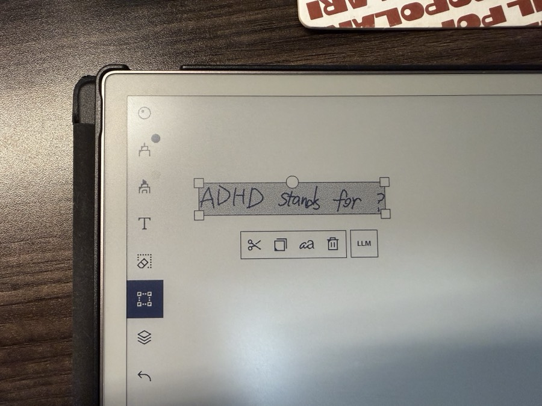
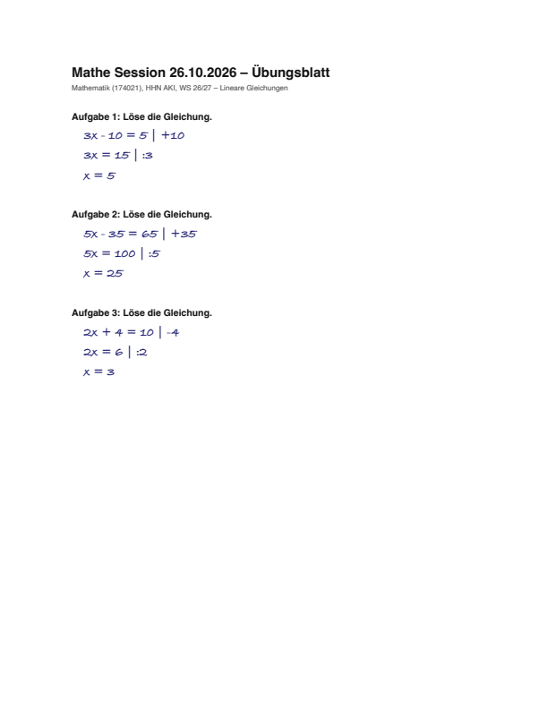

# Referenzen — fremde Projekte

Diese beiden Ordner liegen im Workspace, sind aber **nicht Samuels Arbeit**. Sie stehen hier als Referenz, nicht als Portfolio-Eintrag.

---

## smart_remarkable

**Herkunft:** Rust-Agent von **Yang Wu** (`yangg1224`), Fork von [`awwaiid/ghostwriter`](https://github.com/awwaiid/ghostwriter). Alle 40 Commits stammen von Yang Wu.

**Ein Satz:** Ein Agent, der den Bildschirm des reMarkable an ein Vision-LLM schickt und die Antwort als Text oder als echte Tinte zurückschreibt.

**Kann:**
- Per Ecken-Tap, Vier-Finger-Tap oder injiziertem Button einen Screenshot aus xochitls Framebuffer lesen, an OpenAI, Anthropic oder Google senden und die Antwort tippen oder als SVG-Striche zeichnen.
- Im Select Mode einen handschriftlichen Bereich und einen Zielbereich mit je zwei Ecken markieren; die Antwort erscheint dort als Text oder als verschiebbare Tinte.
- Über eine XOVI-Extension „LLM"- und „Draw"-Buttons direkt in das native Auswahlmenü von xochitl einfügen.
- Zeichnungen per Gemini-Bildmodell erzeugen, auf eine Linienstruktur reduzieren und als Stiftstriche ausgeben.
- Die Pipeline offline mit gespeicherten Screenshots und Touch-Events simulieren.

**Kann nicht:**
- Läuft nicht auf einem normalen reMarkable: SSH/Jailbreak, XOVI-Extension und gerätespezifische Pfade sind Voraussetzung.
- Braucht Cloud-API-Schlüssel und Netzwerk; ein lokales Modell ist nicht vorgesehen.
- Das Web-UI hat keine Authentifizierung; das README warnt ausdrücklich vor `--web-bind 0.0.0.0`.
- Der Select Mode gibt zwischen den Taps keine Bildschirmführung.

**Bild:**

**Warum es hier liegt:** Als Anschauung, wie Tablet-Eingabe, LLM und Stiftausgabe zusammenspielen — und als Vergleichsmaßstab für die eigene Lösung.

**Probleme:**
- Der Web-Server hat keine Authentifizierung.
- Der Select Mode führt nicht durch die vier Taps; Fehlbedienung wird nicht abgefangen.
- Jailbreak, XOVI und Cloud-Anbieter sind harte Abhängigkeiten.
- Unterstützt nur RM2 und Paper Pro.

**Fakten:** Rust (tokio, evdev/uinput, resvg, warp) · ~8.700 Zeilen in 27 Dateien · letzter Commit 2026-10-17 · 36 `#[test]`-Attribute · Fork von `awwaiid/ghostwriter`

---

## math-vision

**Herkunft:** Rust-CLI von **Mikail Plotzky** (`DraftedDev`). Ein einzelner `Init`-Commit, kein Upstream-Remote. Die SymPy- und `--save-ocr`-Erweiterungen im lokalen Arbeitsbaum sind nicht committet.

**Ein Satz:** Ein CLI, das handschriftliche Mathe-PDFs per OCR und lokalem Ollama-VLM prüft und ein annotiertes PDF mit Fehlerrahmen und Korrekturen erzeugt.

**Kann:**
- PDF-Seiten mit pdfium rendern und per PP-StructureV3 Textblöcke mit normalisierten Bounding-Boxes extrahieren.
- Jede Seite als Bild an ein Ollama-VLM schicken und strukturierte Einträge mit Aufgabe, Fehler und Korrektur-LaTeX erhalten.
- Ein annotiertes PDF schreiben: rote Fehlerrahmen, Leader-Linien, Randnotizen mit gerendertem LaTeX, grüne Rahmen für korrekte Aufgaben.
- Zwischenstände speichern und laden sowie die OCR-Ausgabe als JSON exportieren.

**Kann nicht:**
- Kein Rückschreiben aufs Tablet; die Kette endet in einer PDF-Datei.
- Keine Tests im Repo, insbesondere keine Geometrie- oder Golden-Tests.
- Kein stabiler Stand: HEAD und Arbeitsbaum weichen stark voneinander ab.
- Einmaliger CLI-Lauf, kein interaktiver Tutor.

**Bild:**

**Warum es hier liegt:** Als Referenz für PDF-basierte Korrektur — ein anderer Weg als der eigene, bei dem die Seite auf dem Gerät bleibt.

**Probleme:**
- HEAD und Arbeitsbaum divergieren; der aktuelle Stand ist in der Workspace-Doku als `UNKNOWN` markiert.
- Keine Tests, besonders kein Golden-Test für die Koordinaten-Transformation.
- Das Modell entscheidet allein über die Korrektheit; im 12-Aufgaben-Lauf traf es 7/12 Fehlerstellen und erzeugte 5 falsche Negative.
- Die Extraktion schreibt temporäre Seitenbilder ins Arbeitsverzeichnis; parallele Läufe können sich überschreiben.
- Anti-Cheater-Lizenz mit eigenen Nutzungs- und Attributionsbedingungen.

**Fakten:** Rust 2024 (pdfium-render, oar-ocr, ollama-rs, clap), im Arbeitsbaum zusätzlich Python/SymPy · 571 Zeilen im HEAD · letzter Commit 2026-11-03 (`Init` von Mikail Plotzky) · 0 Tests
